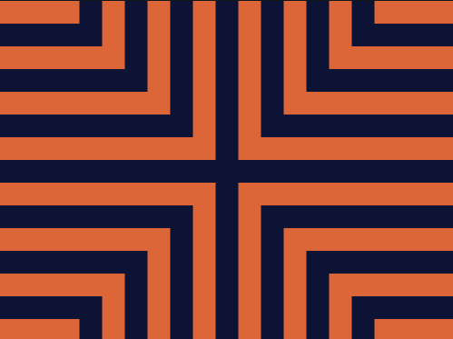
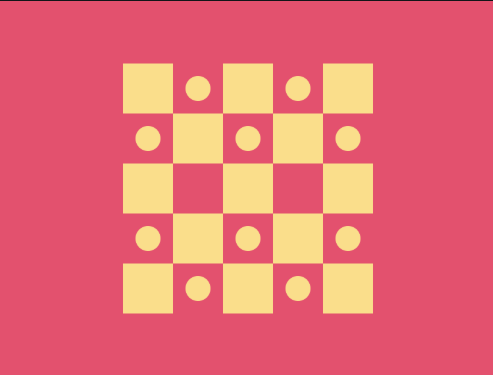
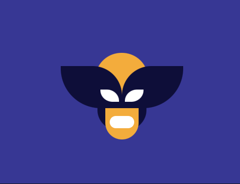
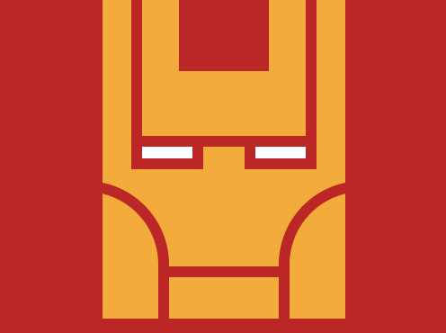
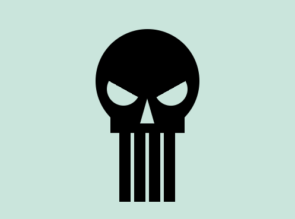
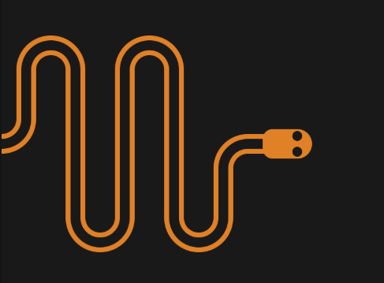

# CSSBattle Solutions

A collection of CSSBattle challenges I solved by recreating designs using **pure HTML and CSS**.

**My CSSBattle profile:** [awyushhk](https://cssbattle.dev/player/awyushhk)

Each folder contains:
- My solution code
- A preview of the recreated design

This repository showcases creative CSS techniques and layout problem-solving through CSSBattle challenges.

## Solved Challenges

  &nbsp;&nbsp;
  &nbsp;&nbsp;
  &nbsp;&nbsp;
  

  &nbsp;&nbsp;
  &nbsp;&nbsp;
  &nbsp;&nbsp;
  

  &nbsp;&nbsp;
  &nbsp;&nbsp;
  &nbsp;&nbsp;
  

  

